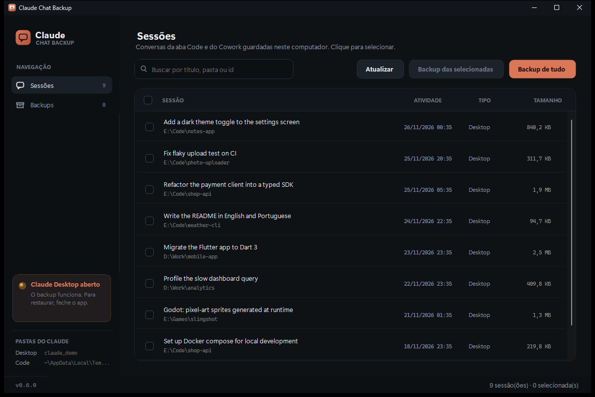

<div align="center">

# Claude Chat Backup

### Back up your Claude Desktop Code and Cowork sessions on Windows, and restore them on another machine.

[](LICENSE)
[](https://dotnet.microsoft.com/)
[](src/Gui)
[](tests/ClaudeChatBackup.Tests)
[](#stack)
[](#build)

[Português](README.pt-BR.md) · [Contributing](CONTRIBUTING.md) · [Security](SECURITY.md) · [Changelog](CHANGELOG.md)



<sub>The real application, captured running against a fictional machine: every session in the screenshot is made up.</sub>

</div>

## What this is

The Claude Desktop app keeps your **Code** and **Cowork** sessions on your own disk: session
metadata under the Desktop data folder and the actual conversation transcripts under
`~\.claude`. Reinstall Windows, change computers or move your projects to another drive, and
those sessions are gone or point at folders that no longer exist.

Claude Chat Backup packs them into a verified ZIP and puts them back — on the same computer or on
a new one, with the project folders remapped to where they live now. One `.exe`, no runtime to
install, a window when you double-click it and a command line when you pass arguments.

> **Not for the Chat tab.** Conversations from the Chat tab (claude.ai) live on Anthropic's
> servers and are not in these files. This tool does not touch them.

> **Built with AI.** This project was planned, implemented and tested in Claude Code sessions.
> It is stated up front so you know what you are reading before you review it or build on it.

## What goes into a backup

| Included | Left out |
|---|---|
| `claude-code-sessions`, `local-agent-mode-sessions` | Desktop `config.json` (login token cache), `ccd-ids.json` |
| Desktop configuration: MCP, presets, extensions | `~\.claude\.credentials.json`, cookies |
| `~\.claude\projects` (transcripts, tool results) | Caches, VM bundles, binaries, logs |
| `~\.claude\file-history`, `skills`, `history.jsonl`, `settings.json`, `CLAUDE.md` | |

Every file is listed in a `manifest.json` with its SHA-256, plus the machine, the Windows user,
the Claude version, the accounts and the project folders it came from. Transcripts that are still
being written are copied up to their last complete line.

**Transcripts can contain anything that was ever pasted into a conversation.** Treat backups as
sensitive data. See [SECURITY.md](SECURITY.md).

## How you use it

Double-click `ClaudeChatBackup.exe`. The interface is in Portuguese (BR).

- **Sessões** (sessions) lists the conversations on this computer. Select rows and use
  **Backup das selecionadas** (back up selected) or **Backup de tudo** (back up everything).
  Backups are written to `backups\` next to the exe.
- **Backups** lists the backups, with **Verificar** (check every file's SHA-256), **Restaurar**
  (restore) and **Excluir** (send to the Windows Recycle Bin). You can also drop a `.zip` onto the
  window or onto the exe icon.
- **F5** or **Atualizar** rereads the disk.

### Restore on another computer

1. Install Claude Desktop, sign in, open it once and close it.
2. Copy `ClaudeChatBackup.exe` and the `.zip` to the new computer and run the exe.
3. In **Backups**, click **Restaurar**.
4. Tick the sessions you want — they start unticked, so nothing is restored by accident.
5. **Trocar pastas** (remap folders) lists the backup's project folders that do not exist here.
   Say where each one went, or leave it blank to keep the path.
6. Click **Analisar** (analyze) to see the plan, then **Restaurar**. If Claude Desktop is running,
   the app offers to close it.

What a restore does:

- Rewrites the user profile, the Claude folders and the remapped folders inside sessions and
  transcripts. Paths quoted in the text of a conversation are left alone.
- Renames `~\.claude\projects\<folder>` to match the new working folder.
- Moves the sessions to the signed-in account when the computer has only one.
- By default replaces a file only when the backup copy is newer. Before replacing anything it
  saves the current state to `antes-da-restauracao-<date>.zip`, which can itself be restored.
- Verifies the whole backup before writing: a corrupted backup restores nothing.

## Command line

With arguments, the same exe runs in the terminal:

```
ClaudeChatBackup paths
ClaudeChatBackup list [--from backup.zip]
ClaudeChatBackup backup [--out x.zip] [--session <id>]
ClaudeChatBackup verify backup.zip
ClaudeChatBackup restore backup.zip --map "D:\Code=E:\Code" [--session <id>] [--dry-run] [--close-claude]
```

`ClaudeChatBackup help` lists every option, including `--desktop-dir`, `--claude-dir` and `--home`
to point the tool at copies instead of your real data.

## Safety rules

These are enforced by the code, not just documented:

- Restoring is blocked while Claude Desktop is running, because it rewrites its sessions on exit.
  The window offers to close it; the command line requires `--close-claude` or `--force`.
- Every restore checks every file's SHA-256 before writing anything.
- Overwritten files are saved first to `antes-da-restauracao-<date>.zip`.
- Path remapping only changes JSON values that **start with** a mapped folder. Free text in
  conversations is never altered, and lines with nothing to change keep their original bytes.
- Login tokens, credentials and cookies never enter a backup.

## Stack

- C# on .NET 10 (`net10.0-windows`), WinForms with a fixed dark theme.
- **No runtime packages beyond the base class library**: ZIP from `System.IO.Compression`, JSON
  from `System.Text.Json`, hashes from `System.Security.Cryptography`.
- xUnit for the tests.
- Layers: `Domain` (pure, no I/O), `Application` (use cases), `Infrastructure` (disk, ZIP,
  processes), `Cli` and `Gui` (presentation, with testable view models).

## Build

```powershell
# Build and test
dotnet build ClaudeChatBackup.slnx
dotnet test ClaudeChatBackup.slnx

# Portable, self-contained single exe (~49 MB) in dist\portable
powershell -ExecutionPolicy Bypass -File .\build-portable.ps1

# Smaller build that needs the .NET 10 runtime installed, in dist\release
powershell -ExecutionPolicy Bypass -File .\build-release.ps1
```

The portable build is large because WinForms does not support trimming.

## Limits

- Windows only. Interface and command-line messages are in Portuguese (BR).
- The Chat tab (claude.ai) is out of scope: those conversations are not on disk.
- Cowork sessions are copied and restored in a full restore, but they are not listed and cannot be
  picked in a partial restore.
- Claude's file formats are undocumented and may change between versions. The backup stores raw
  files and records the Claude version in the manifest. How the tool finds each folder is written
  up in [docs/LEVANTAMENTO.md](docs/LEVANTAMENTO.md) (Portuguese).
- The list does not refresh by itself when files change outside the app; use **F5**.

## Not affiliated with Anthropic

This is an independent tool. It is not made, endorsed or supported by Anthropic. "Claude" and
"Claude Code" are trademarks of Anthropic, used here only to say what the tool works with.

## License

[MIT](LICENSE) © 2026 Claudney Sarti Sessa
