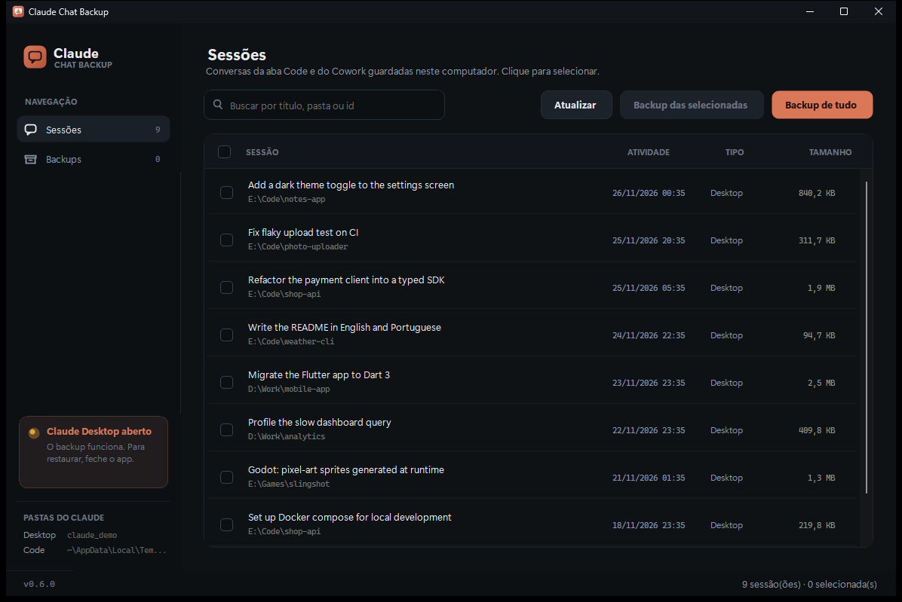

<div align="center">

# Claude Chat Backup

### Backup das sessões das abas Code e Cowork do Claude Desktop no Windows, com restauração em outro computador.

[](LICENSE)
[](https://dotnet.microsoft.com/)
[](src/Gui)
[](tests/ClaudeChatBackup.Tests)
[](#stack)
[](#compilar)

[English](README.md) · [Contribuir](CONTRIBUTING.md) · [Segurança](SECURITY.md) · [Changelog](CHANGELOG.md)



<sub>O aplicativo real, capturado rodando sobre uma máquina fictícia: todas as sessões do print são inventadas.</sub>

</div>

## O que é

O Claude Desktop guarda as sessões das abas **Code** e **Cowork** no seu próprio disco: os
metadados na pasta de dados do Desktop e as conversas de verdade em `~\.claude`. Reinstale o
Windows, troque de computador ou mude os projetos de unidade, e essas sessões somem ou passam a
apontar para pastas que não existem mais.

O Claude Chat Backup empacota tudo num ZIP verificado e devolve depois — no mesmo computador ou
num novo, com as pastas de projeto trocadas para onde elas estão agora. Um único `.exe`, sem
instalar runtime: abre uma janela com dois cliques e vira linha de comando quando recebe
argumentos.

> **Não cobre a aba Chat.** As conversas da aba Chat (claude.ai) ficam nos servidores da
> Anthropic e não estão nesses arquivos. A ferramenta não mexe nelas.

> **Feito com IA.** Este projeto foi planejado, implementado e testado em sessões do Claude
> Code. Isso vem dito logo de início para você saber o que está lendo antes de revisar ou
> construir em cima.

## O que entra no backup

| Entra | Fica de fora |
|---|---|
| `claude-code-sessions`, `local-agent-mode-sessions` | `config.json` do Desktop (cache do token de login), `ccd-ids.json` |
| Configuração do Desktop: MCP, presets, extensões | `~\.claude\.credentials.json`, cookies |
| `~\.claude\projects` (transcripts, resultados de ferramentas) | Caches, VM bundles, binários, logs |
| `~\.claude\file-history`, `skills`, `history.jsonl`, `settings.json`, `CLAUDE.md` | |

Cada arquivo aparece num `manifest.json` com o SHA-256, junto com a máquina, o usuário do
Windows, a versão do Claude, as contas e as pastas de projeto de origem. Transcripts que ainda
estão sendo gravados entram só até a última linha completa.

**Os transcripts podem conter qualquer coisa que foi colada numa conversa.** Trate os backups
como dados sensíveis. Veja o [SECURITY.md](SECURITY.md).

## Como usar

Dê dois cliques em `ClaudeChatBackup.exe`.

- **Sessões** lista as conversas deste computador. Clique nas linhas para selecionar e use
  **Backup das selecionadas** ou **Backup de tudo**. Os backups vão para `backups\` ao lado do exe.
- **Backups** lista os backups com **Verificar** (confere o SHA-256 de cada arquivo),
  **Restaurar** e **Excluir** (manda para a Lixeira do Windows). Também dá para arrastar um `.zip`
  para a janela ou para o ícone do exe.
- **F5** ou **Atualizar** relê o disco.

### Restaurar em outro computador

1. Instale o Claude Desktop, faça login, abra uma vez e feche.
2. Copie o `ClaudeChatBackup.exe` e o `.zip` para o computador novo e abra o exe.
3. Em **Backups**, clique em **Restaurar**.
4. Marque as sessões que quer — elas começam desmarcadas, para nada ser restaurado sem querer.
5. Em **Trocar pastas** aparecem as pastas de projeto do backup que não existem aqui. Informe para
   onde cada uma foi, ou deixe em branco para manter o caminho.
6. Clique em **Analisar** para ver o plano e depois em **Restaurar**. Se o Claude Desktop estiver
   aberto, o app oferece fechá-lo.

O que a restauração faz:

- Troca o perfil do usuário, as pastas do Claude e as pastas informadas dentro das sessões e
  transcripts. Caminhos citados no texto das conversas não mudam.
- Renomeia `~\.claude\projects\<pasta>` para a nova pasta de trabalho.
- Move as sessões para a conta logada quando o computador tem só uma.
- Por padrão substitui um arquivo só quando a cópia do backup é mais nova. Antes de substituir,
  guarda o estado atual em `antes-da-restauracao-<data>.zip`, que também pode ser restaurado.
- Confere o backup inteiro antes de gravar: backup corrompido não restaura nada.

## Linha de comando

Com argumentos, o mesmo exe funciona no terminal:

```
ClaudeChatBackup paths
ClaudeChatBackup list [--from backup.zip]
ClaudeChatBackup backup [--out x.zip] [--session <id>]
ClaudeChatBackup verify backup.zip
ClaudeChatBackup restore backup.zip --map "D:\Code=E:\Code" [--session <id>] [--dry-run] [--close-claude]
```

`ClaudeChatBackup help` lista todas as opções, inclusive `--desktop-dir`, `--claude-dir` e
`--home`, que apontam a ferramenta para cópias em vez dos seus dados reais.

## Regras de segurança

Garantidas pelo código, não só documentadas:

- Restaurar é bloqueado com o Claude Desktop aberto, porque ele regrava as sessões ao sair. A
  janela oferece fechá-lo; a linha de comando exige `--close-claude` ou `--force`.
- Toda restauração confere o SHA-256 de cada arquivo antes de gravar qualquer coisa.
- Arquivos substituídos são guardados antes em `antes-da-restauracao-<data>.zip`.
- A troca de caminhos só altera valores JSON que **começam** com uma pasta mapeada. O texto livre
  das conversas nunca muda, e linhas sem nada a trocar mantêm os bytes originais.
- Tokens de login, credenciais e cookies nunca entram num backup.

## Stack

- C# sobre .NET 10 (`net10.0-windows`), WinForms com tema escuro fixo.
- **Nenhum pacote de runtime além da biblioteca padrão**: ZIP com `System.IO.Compression`, JSON
  com `System.Text.Json`, hash com `System.Security.Cryptography`.
- xUnit nos testes.
- Camadas: `Domain` (puro, sem I/O), `Application` (casos de uso), `Infrastructure` (disco, ZIP,
  processos), `Cli` e `Gui` (apresentação, com view models testáveis).

## Compilar

```powershell
# Build e testes
dotnet build ClaudeChatBackup.slnx
dotnet test ClaudeChatBackup.slnx

# Portable, exe único self-contained (~49 MB) em dist\portable
powershell -ExecutionPolicy Bypass -File .\build-portable.ps1

# Versão menor, que depende do runtime .NET 10 instalado, em dist\release
powershell -ExecutionPolicy Bypass -File .\build-release.ps1
```

O portable é grande porque o WinForms não suporta trimming.

## Limites

- Só Windows. Interface e mensagens da linha de comando em português.
- A aba Chat (claude.ai) está fora do escopo: essas conversas não estão no disco.
- As sessões do Cowork são copiadas e voltam numa restauração completa, mas não aparecem na lista
  e não podem ser escolhidas numa restauração parcial.
- O formato dos arquivos do Claude não é documentado e pode mudar entre versões. O backup guarda
  os arquivos brutos e registra a versão do Claude no manifesto. Como a ferramenta encontra cada
  pasta está em [docs/LEVANTAMENTO.md](docs/LEVANTAMENTO.md).
- A lista não se atualiza sozinha quando arquivos mudam fora do app; use **F5**.

## Sem vínculo com a Anthropic

Ferramenta independente. Não é feita, endossada nem suportada pela Anthropic. "Claude" e
"Claude Code" são marcas da Anthropic, citadas aqui só para dizer com o que a ferramenta
funciona.

## Licença

[MIT](LICENSE) © 2026 Claudney Sarti Sessa
